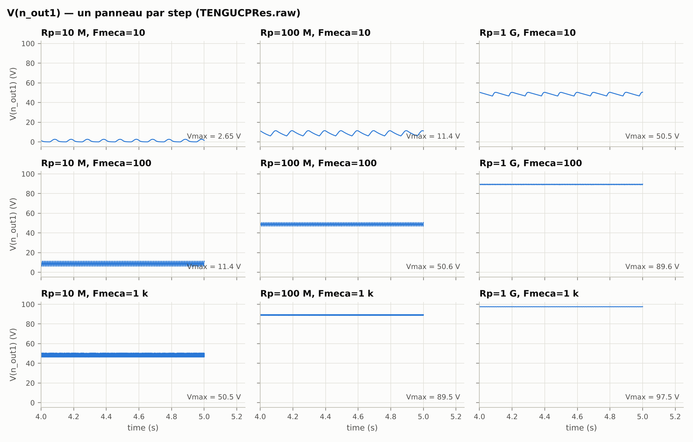
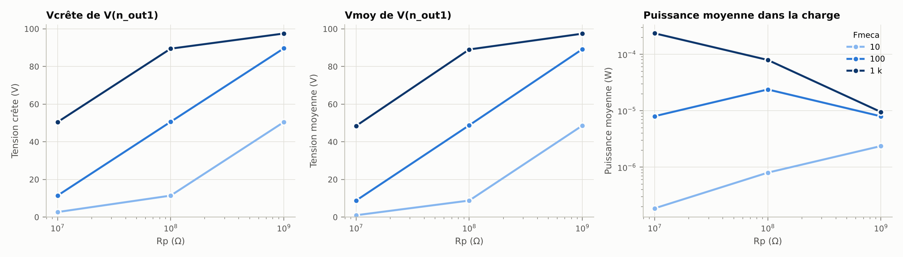

# SPICE_IO

Outils Python pour **piloter LTspice**, **lire ses fichiers de résultats `.raw`** et
**tracer les résultats avec matplotlib**.

Le dépôt est construit autour d'un exemple concret : un générateur triboélectrique (TENG)
suivi d'une pompe de charge, dont on cherche la résistance de charge qui maximise la
puissance récupérée (`netlists/TENGUCPRes.cir`).

| Fichier | Rôle |
|---|---|
| `ltspice_raw.py` | Lecteur de fichiers `.raw` LTspice (ne dépend que de numpy) |
| `analyse_ltspice.py` | Indicateurs et figures à partir d'un `.raw`, y compris issu d'un `.step` |
| `simu_spicelib.py` | Balayage de paramètres **sans `.step`** : une simulation LTspice par jeu de valeurs, via [spicelib](https://github.com/nunobrum/spicelib) |
| `ltspice_run.py` | Alternative minimale à spicelib pour lancer LTspice en mode batch |
| `netlists/` | `TENGUCPRes.cir` (circuit TENG) et `exemple.cir` (redresseur simple) |
| `docs/` | Figures produites à partir d'une simulation de `TENGUCPRes.cir` |

## Installation

```bash
pip install -r requirements.txt
```

LTspice doit être installé pour lancer des simulations (`simu_spicelib.py`, `ltspice_run.py`).
La lecture et l'analyse d'un `.raw` existant n'en ont pas besoin.

## Lire un fichier `.raw` — `ltspice_raw.py`

```python
from ltspice_raw import LTSpiceRaw

raw = LTSpiceRaw("TENGUCPRes.raw")
print(raw)                              # analyse, traces, steps et leurs paramètres

t = raw.axis(step=0)                    # temps (ou fréquence, ou variable balayée en .dc)
v = raw.get("V(n_out1)", step=0)        # une trace pour un step donné
v_tout = raw["V(n_out1)"]               # tous les steps à la suite

for i, t, v in raw.steps("V(n_out1)"):  # step par step
    print(raw.step_label(i), v.max())   # ex. "Rp=100 M, Fmeca=10  11.46"

t_u, v_u = raw.resample("V(n_out1)", step=0, dt=1e-4)   # pas régulier, pour une FFT
```

Formats pris en charge :

- en-tête UTF-16 (LTspice XVII / 24) ou ASCII, données binaires ou texte (`Values:`) ;
- analyses `.tran`, `.ac` (complexe), `.dc`, `.noise`, `.op`, `.tf` ;
- drapeaux `double`, `fastaccess`, `stepped`.

Pour les simulations `.step`, les runs sont séparés automatiquement. Les valeurs des
paramètres de chaque run sont lues :

1. dans le `.log` qui porte le même nom que le `.raw` ;
2. à défaut, dans la netlist `.cir` / `.net` de même nom (ou passée avec `netlist_path=`),
   en interprétant les directives `.step` (`lin`, `dec`, `oct`, `list`).
   Comme dans LTspice, **le premier `.step` est la boucle la plus interne**.

Autres fonctions : `to_dataframe()` (pandas), `step_value(i, "Rp")`, `parse_spice_number("4.7k")`.

## Analyser un `.raw` — `analyse_ltspice.py`

```bash
python analyse_ltspice.py TENGUCPRes.raw --netlist netlists/TENGUCPRes.cir --rload-param Rp --tmin 4
```

- `--netlist` : netlist d'où lire les `.step` (inutile si le `.log` ou le `.cir` est à côté du `.raw`) ;
- `--step NOM=v1,v2,...` : valeurs des `.step` données à la main, à répéter dans l'ordre de la netlist ;
- `--rload-param` : paramètre qui est la résistance de charge (active le calcul de puissance) ;
- `--tmin` / `--tmax` : fenêtre de mesure, par exemple le régime établi ;
- `--trace`, `--out`, `--show`.

Sorties dans `figures/` : `metriques.csv` (Vmax, Vmin, Vcc, Vmoy, Vrms, puissance et énergie par step),
un panneau par step, tous les steps superposés, et les indicateurs en fonction du paramètre balayé.
Les intégrales tiennent compte du pas de temps variable de LTspice.




## Balayage sans `.step` — `simu_spicelib.py`

```bash
python simu_spicelib.py netlists/TENGUCPRes.cir --parallel 8
python simu_spicelib.py netlists/TENGUCPRes.cir --ltspice "C:/Program Files/ADI/LTspice/LTspice.exe"
```

Le script :

1. ouvre la netlist avec `spicelib.SpiceEditor`, retire **tous** les `.step` et remplace la
   directive `.tran` par `.tran 0 {tstop}` ;
2. construit le plan de simulation dans `build_jobs()` : pour chaque fréquence `Fmeca`, une plage
   de `Rp` centrée sur Rp·Fmeca ≈ 10¹⁰ (± 2 décades, 4 points par décade), et une durée `tstop`
   propre à chaque run (≥ 10·Rp·Crect et ≥ 100 périodes mécaniques, plafonnée à 60 s) ;
3. lance les simulations en parallèle avec `spicelib.SimRunner` ;
4. relit chaque `.raw` avec `spicelib.RawRead`, calcule tension et puissance moyennes sur les
   20 dernières périodes et **vérifie le régime établi** (variation < 1 % par rapport à la
   fenêtre précédente) ;
5. écrit `sim_out/resultats.csv` et `sim_out/balayage.png`, et affiche la charge optimale pour
   chaque fréquence.

Pour un autre circuit, adaptez les constantes `TRACE`, `R_PARAM`, `FREQS` et la fonction `build_jobs()`.

### Netlists et parseur de spicelib

Le parseur de spicelib est plus strict que LTspice. `normalise_netlist()` corrige
automatiquement, **sur une copie**, les trois écarts rencontrés :

- la première ligne (le titre) doit commencer par `*` ;
- un commentaire `;` doit être précédé d'une espace (`...time) ;V=...` et non `...time);V=...`) ;
- la netlist doit se terminer par `.end`.

## Lancer LTspice sans spicelib — `ltspice_run.py`

```python
from ltspice_run import LTspiceRunner

sim = LTspiceRunner()                                  # ou LTspiceRunner(exe=r"C:\...\LTspice.exe")
raw = sim.run("netlists/exemple.cir", params={"rload": "1meg"})
results = sim.sweep("netlists/exemple.cir", [{"rload": r} for r in ("1k", "10k", "100k")])
```

L'exécutable est cherché aux emplacements d'installation habituels (LTspice 24 et XVII sous
Windows, macOS, Wine sous Linux) ou dans la variable d'environnement `LTSPICE_EXE`.

## Limites connues

- Les scripts de simulation ont été testés avec un simulateur factice qui imite le mode batch
  de LTspice, pas avec LTspice lui-même.
- Le lecteur suppose le format `.raw` de LTspice. Les `.raw` binaires de ngspice (tout en double
  précision, sans drapeau `double`) demanderaient une petite adaptation.
- `spicelib.RawRead` échoue sur un `.raw` issu d'un `.step` si le `.log` est absent ;
  `ltspice_raw.LTSpiceRaw` reste utilisable dans ce cas.
